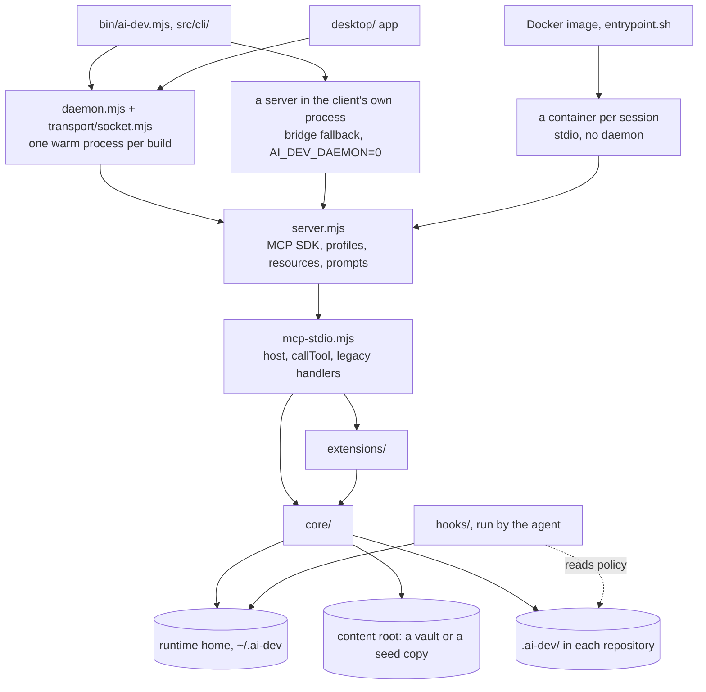
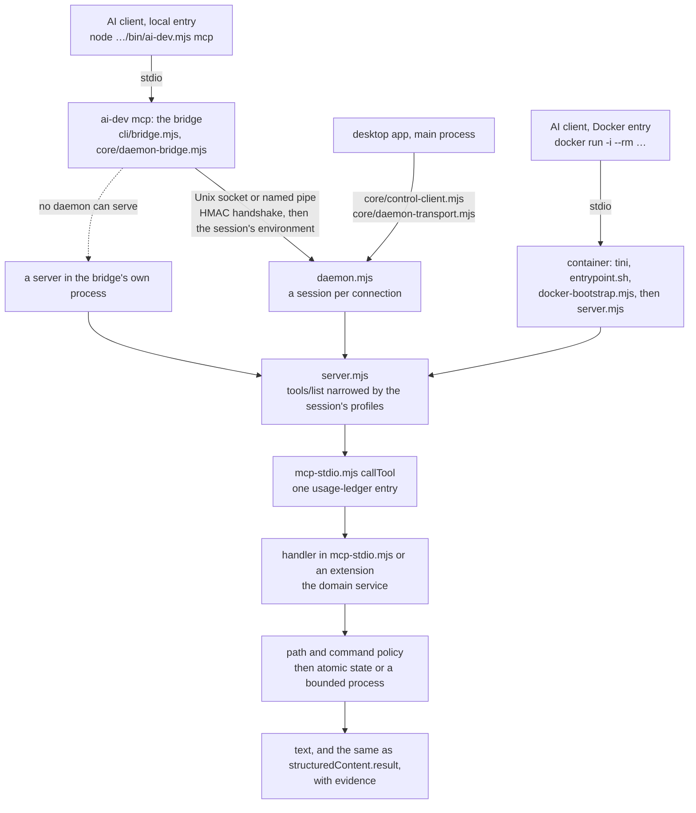

# AI Dev MCP vNext Architecture

## Goals

- Give Codex and Claude compact, current project context instead of dumping the vault.
- Route each task to at most three relevant skills.
- Bind completion claims to acceptance criteria and machine-readable evidence.
- Keep local operation offline-first while using the standard MCP protocol.
- Make every write recoverable and every executable command explicit.

## Runtime Layers



1. `bin/ai-dev.mjs` and `src/cli/`: the one command line ([The CLI](#the-cli)).
2. `server.mjs`: official MCP SDK transport, protocol capabilities, resources, prompts, capability profiles
   (`core/tool-profiles.mjs`), and tool registration.
3. `daemon.mjs` + `transport/socket.mjs`: the same server over a local Unix socket or Windows named pipe, one warm
   process per build for every client of the user, so the index and the model load once and the state has one
   writer. Every 3.0 local entry runs `ai-dev mcp`, which bridges the client to it (a 2.x entry,
   `node src/server.mjs`, serves the client in its own process); a Docker entry runs the image's stdio server in
   a container per session, with no daemon ([The Daemon](#the-daemon), [SECURITY.md](SECURITY.md#the-daemon)).
4. `mcp-stdio.mjs`: composed domain-service facade and legacy-compatible rollback handler.
5. `tool-definitions.mjs`: typed MCP contracts separated from dispatch and implementation.
6. `core/`: path policy, atomic storage, command policy, process execution, canonical project
   identity, context compilation, task state, routing, outcome analytics, overlays, dashboard,
   frontend quality, install layouts, the runtime home, the daemon's channel and client, the local
   model, and runtime distribution.
7. `extensions/`: capabilities registered from outside `mcp-stdio.mjs` (see below).
8. `hooks/`: standalone scripts run by the *agent*, not by the server (see below).
9. `core/search-*.mjs`: the SQLite FTS index on `node:sqlite` and BGE-M3 hybrid retrieval (see `search` below).
10. Obsidian: human-readable knowledge, generated project cards, workflows, and reports — the content root
    ([Install Layouts](#install-layouts)).
11. The runtime home, `AI_DEV_HOME` (default `~/.ai-dev`): runtime task state and evidence that should not clutter
    the vault, and the index, the model and the daemon's files ([The Runtime Home](#the-runtime-home)).
12. `desktop/`: the Electron app, a client of the daemon through the control API
    ([The Desktop App And The Windows Installer](#the-desktop-app-and-the-windows-installer)).

Archify is a local, vendored diagram capability. Its nine typed MCP tools and
artifact/evidence contract are documented in [ARCHIFY.md](ARCHIFY.md).

Frontend product projects add a repository-local state machine:

```text
.ai-dev/frontend/product-quality.json
-> approved document hashes and pre-code baseline
-> immutable visual references
-> strict Playwright state evidence
-> independent hash-bound visual review
-> handoff gate
```

`core/frontend-product-quality.mjs` owns the pure routing, policy, document, scorecard, and gate rules. The existing Frontend QA runner owns browser execution and pixel comparison; Frontend Product Quality v2 composes it instead of creating a competing runner.

When approved references do not exist, `core/reference-factory.mjs` adds a bounded two-stage artifact
contract:

```text
concept manifest
-> client ImageGen/Figma execution
-> PNG/path/hash/prompt/inspection validation
-> candidate direction registration
-> independent Concept Jury
-> direction approval
-> coverage manifest for the approved direction only
-> immutable baseline registration
```

The MCP server never claims external image-tool execution. It creates and validates manifests; the
client performs generation and visual inspection.

### Extensions

`src/mcp-stdio.mjs` is capped by the static quality gate, so a new capability is not written into
it. `src/tool-extensions.mjs` holds a registry of factories; each module under `src/extensions/`
exports one:

```js
createXxxTools(host) -> { definitions, handlers, readOnly }
```

`host` is assembled once by `mcp-stdio.mjs` and carries the shared runtime services an extension is
allowed to touch — `taskStore`, `usageLedger`, `sessionStore`, `instinctStore`, project identity and
project-file helpers, the vault layout (`vaultPaths`) and its readers and writers, the live status
sources (search index, embedding backend, registries), and `callTool` for composing existing tools.
The dependency runs one way: extensions never import `mcp-stdio.mjs`, which would both cycle and
couple pure logic to the vault. Duplicate tool names and definitions without a handler throw at
startup, so a broken extension can never reach a client.

Registered today: `control`, `coverage`, `decisions`, `epics`, `frontend-design`, `frontend-qa`, `galaxy`,
`hooks`, `hygiene`, `instincts`, `lifecycle`, `mcp-inventory`, `plans`, `projects`, `pull-requests`, `rules`,
`search`, `security`, `sessions`, `skills`, `snapshots`, `state`, `system`, `usage`, `worktrees`. Pure logic
stays in `core/` (`decision-ledger.mjs`, `agent-hooks.mjs`, `change-hygiene.mjs`, `coverage-reports.mjs`,
`instincts.mjs`, `task-plans.mjs`, `task-epics.mjs`, `pull-request.mjs`,
`pr-template.mjs`, `rules-library.mjs`, `rules-catalog.mjs`, `session-memory.mjs`,
`security-scan.mjs`, `security-fix-plan.mjs`, `state-pruning.mjs`,
`skill-catalog.mjs`, `skill-cards.mjs`, `skill-registry-docs.mjs`,
`skill-quality-report.mjs`, `skill-recommendation.mjs`, `frontend-product-quality.mjs`,
`reference-factory.mjs`, `reference-factory-artifacts.mjs`, `frontend-qa-report.mjs`,
`search-runtime.mjs`, `search-eval.mjs`, `project-cards.mjs`, `project-markdown.mjs`,
`quality-gate-runner.mjs`, `task-verification.mjs`, `task-completion.mjs`,
`system-health.mjs`, `system-dashboard.mjs`, `text-format.mjs`, `usage-ledger.mjs`,
`task-worktrees.mjs`, `task-snapshots.mjs`, `policy-rules.mjs`, `mcp-inventory.mjs`,
`toml-lite.mjs`, and the `galaxy*.mjs` family); the extension is the MCP surface over it.

`control` is the desktop app's surface ([CONTROL-API.md](CONTROL-API.md)): the install's status,
setup, the local model, the AI clients, logs, settings and a work overview, as an opt-in profile with a
versioned contract ([The Control API Contract](#the-control-api-contract)). The logic it drives is shared
with the CLI: `core/setup-runner.mjs` runs `ai-dev setup` and `setup_run` alike, `core/client-connections.mjs`
`ai-dev clients` and the `clients_*` tools, `core/model-manager.mjs` `ai-dev model` and the `model_*` tools,
and `core/settings.mjs` keeps `~/.ai-dev/config.json` and fills the environment from it when a command starts;
`core/log-tail.mjs`, `core/serving-process.mjs` and `core/workspace-overview.mjs` serve one tool each. A program
reaches the daemon with `core/daemon-transport.mjs`, an MCP SDK transport over its socket.

The Knowledge Galaxy (`render_knowledge_galaxy`, [docs/GALAXY.md](../../docs/GALAXY.md)) is the one
extension that also ships browser code. `src/galaxy/` holds the viewer as ordinary ES modules, so
each is readable and its pure half is tested in Node; `core/galaxy-page.mjs` joins them into the
single inline module the generated page runs, because a page opened from disk cannot fetch a second
file. The line ceiling below covers that directory too.

`core/` is not only pure logic. A handful of modules there are services: they run processes
or own state, but know nothing about MCP and take everything environment-specific as a
dependency. `process-runner.mjs` and `input-process-runner.mjs` were the first; then came
`search-index.mjs` and the embedding pool (since 3.0, `dense-runtime.mjs` over the ONNX
worker), and `project-detection.mjs`.
The rule they follow is that the launcher, the paths and the collaborators arrive as
arguments, so the module is testable against a stub rather than against an installed
toolchain.
`core/completion-claims.mjs` has no extension of its own: the `lifecycle` extension is its only
caller.

The `hooks` extension also owns the rules the installed guard enforces. `core/policy-rules.mjs`
is the writing end of the `rules` block in `.ai-dev/policy.json`: it compiles a pattern the way
`hooks/lib.mjs` compiles it, refuses one that cannot work (a pattern that does not compile, an
event the guard never evaluates, a quantified group holding an unbounded quantifier), refuses a
second rule with the same pattern for the same event (`all` counts as either), and refuses a new
pattern that does not match the example the caller provides. The example is stored on the rule, so
`list_policy_rules` re-runs it and reports a rule a hand edit silently disarmed. Nothing here imports
the hook pack: the hooks
are copied into other repositories and must not depend on server code, so the compile flags and
the match text are mirrored, and tests pin the mirror ([Hook and server duplicates](#hook-and-server-duplicates)).

`mcp-inventory` reads the other half of the harness: which MCP servers the repository wires into
its agents. `core/mcp-inventory.mjs` reads `.mcp.json`, both Claude Code settings files,
`.cursor/mcp.json`, `.vscode/mcp.json`, `.gemini/settings.json` and `.codex/config.toml` — the
last through `core/toml-lite.mjs`, a reader for the TOML subset those files use, because a third
dependency costs more review than the parser does. One entry per server names the files that
declare it, the transport, the environment substitutions and whether they resolve, and Claude
Code's approval state. A credential written out in a config file is a `block` finding, masked out
of the command line the report echoes back.

`snapshots` keeps a turn undoable. `core/task-snapshots.mjs` records the whole working tree of a
task — tracked changes, staged or not, plus the files the agent created — as one commit object
that no branch points at, held by a ref under `refs/ai-dev/snapshots/<task_id>/<n>`, and
`rollback_task` restores those files and removes the ones that appeared since. Nothing is
written to the user's branch, their stash or their index; `.gitignore` decides what is carried,
so dependencies and build output stay out of it. The lifecycle drives it at both ends:
`checkpoint_task` snapshots the turn it records (a repository that cannot be snapshotted leaves
a reason, never an error), and `complete_task` deletes the refs the closed task no longer needs.
A rollback snapshots the state it is about to replace, so it can itself be rolled back.

`pull-requests` is the one extension that reads from every other: `prepare_pull_request`
projects a task record, its verifications, its decisions and its plan onto the repository diff
and writes `.ai-dev/pr/<task_id>.md`. It fills the repository's own pull request template when
there is one (`core/pr-template.mjs` discovers, parses and fills it), and it stops at text —
`git push` and `gh pr create` are returned as commands, never executed, so publishing stays a
human decision. `complete_task` prepares the same file and links it from `next_step`.

`system`, `skills`, `frontend-design`, `frontend-qa`, `search`, `projects` and `lifecycle` are
extractions from `mcp-stdio.mjs` rather than new capabilities; each moved out with its
definitions and each splits the same way, I/O in the extension and judgement in `core/`. Those
six steps took the main module from 10,018 lines to 4,775;
[Line Budgets](#line-budgets) keeps it from growing back.

`system` carries `system_health_check`, `rebuild_system_dashboard` and `system_dashboard_status`.
Its checks fetch through `host` and hand the raw status objects to pure evaluators in
`core/system-health.mjs`, which also assembles the dashboard snapshot.

### Skill routing: three conventional slots plus reserved ones

`recommend_skills` answers with at most three conventional skills — one workflow, plus domain and
verification skills — chosen deterministically by `core/skill-router.mjs` from the task text. Those
three are ours: they carry the verification contract the task lifecycle checks against, so nothing
displaces them.

Beside them sit the reserved roles (`RESERVED_ROUTING_ROLES`), which do not consume the three:

- `capability` — an add-on tool such as Archify, matched by a routing rule. It is not an
  alternative to a workflow skill, so it does not compete for a slot.
- `specialist` — at most one imported skill (`external/*`, `design/*`), picked by
  `pickTaskSpecialist` in `core/skill-recommendation.mjs`. It earns the slot the way its author
  intended: by its `use_when` answering the task's situation. The 101 skills imported from ECC
  could otherwise never appear at all, because our own three always fill the conventional slots.

The specialist is matched through `core/task-vocabulary.mjs`, which translates the concepts a
Russian task names into the English terms an imported catalogue is written in — "настроить
разработку через тесты" and `tdd-workflow`'s "test-driven development" share no substring, so a
plain text score was always zero. The table names concepts, never skills, so an import benefits
from it without an entry being added. Three rules keep the offer honest: the situation text has to
match (a name the task happens to contain is not enough), an import that shadows one of our names
is never offered, and a skill that declares an ecosystem loses points when neither the task nor
the project mentions it — and is refused outright when the project has a stack and this is not it.

### Imported skills: what limits foreign text, and what does not

Imported skills carry `trust: known-upstream` and `instruction_policy: data-until-review`. Both
are **metadata, not a mechanism**: nothing in this server reads `instruction_policy` before doing
or refusing anything, and changing it to `trusted` would change no behaviour. They are an
inventory — they say the catalogue contains text nobody here has read — and a decision built on
them is a decision built on a label.

What actually keeps a hundred imported texts out of an agent's context is the shape of the
context pack:

- `compileContextPack` (`core/context-compiler.mjs`) renders three things per routed skill —
  name, source, and the reason it was routed. A skill's body is never inlined, whatever its
  trust level.
- The pack object carries the skill's `path`, so the agent can open it. That is the intended
  boundary: an imported skill is a reading suggestion, and reading it is a deliberate act.
- An import that shadows one of our skill names is never routed at all, and a routed imported
  specialist gets its own slot beside the routed core rather than displacing part of it.
- Quality scoring (`skillQualityRankAdjustment`) moves an imported skill's rank, not its
  trustworthiness: `maturity: draft` and `quality_status: fail` push it down the list.

So the protection is that foreign text does not arrive on its own, not a promise that it is
harmless.

### Extracted extensions: skills, frontend, search, projects, lifecycle

`skills` carries `rebuild_index`, `validate_skill_library` and `recommend_skills` — the generated
skill catalog end to end. The extension reads the vault, the skill sources and the embedding
backend; the renders and verdicts are `core/skill-cards.mjs` (cards),
`core/skill-registry-docs.mjs` (registry files and their Markdown),
`core/skill-quality-report.mjs` (the validation report and its dashboard) and
`core/skill-recommendation.mjs` (task intent, filtering and ranking), over the shared vocabulary in
`core/skill-catalog.mjs`. Two things stayed behind deliberately: the skill collectors and the
taxonomy/card writers, because `import_skill_repo`, `rebuild_skill_taxonomy` and `sync_skill_cards`
share them, and `projectRecommendationContext`, which is project-card I/O. Both reach the extension
through `host`. The traffic runs the other way too — `import_skill_repo` and the overlay tools call
`rebuild_index`, and `begin_task` calls `recommend_skills` — and both go through
`extensions.handlers`, so the tool stays the single implementation.

`frontend-design` and `frontend-qa` are one capability cut in two, because the Frontend Product
Quality surface is larger than one 800-line module. `frontend-design` carries the inputs a product
is built from: the Reference Factory (`plan_frontend_references` mints a manifest of image jobs,
`register_frontend_references` accepts the generated PNGs only against per-artifact inspection
evidence) and `generate_ui_ux_design_system`. `frontend-qa` carries the evidence that the built
thing works: `run_frontend_qa` drives the browser runner, `run_visual_reference_qa` is the strict
form of it behind the implementation gate, and `record_visual_review` records an independent
reviewer's verdict and hashes every artifact as it is reviewed.

What did not move is the frontend product state itself. `readFrontendProductState`,
`frontendProductDocumentHashes`, `frontendReviewArtifactsCurrent` and the reference validators stay
in `mcp-stdio.mjs` and reach the extensions through `host`, because `compile_project_context`,
`verify_task`, `frontend_product_gate` and the rest of the product state machine read them too.
`verify_task` calls `run_frontend_qa` back through `extensions.handlers`, so the tool stays the
single implementation of a browser run.

Their pure halves are `core/reference-factory-artifacts.mjs` (where a manifest's files live, what a
registry entry looks like, PNG structure, and whether an artifact is one a reviewer could have
inspected) and `core/frontend-qa-report.mjs` (the runner's stdin contract, the Markdown report, the
artifact list a review has to cover, and the strict verdict). `core/frontend-product-quality.mjs`
and `core/reference-factory.mjs` already held the state machine and the manifest logic and were not
touched: both are pinned in the static gate's `MODULE_LINE_EXCEPTIONS` and may only shrink.

`search` is the MCP surface over three layers. `core/search-index.mjs` owns the sqlite index:
whether this Node can serve it at all (`node:sqlite` with FTS5, 22.16+ and 24+ — anywhere else
every search tool says which Node it needs), when to refresh it (writers call `markDirty`, the
next query refreshes once, in place, and concurrent queries share that refresh), and what to do
with an answer — the dense query vector is embedded in-process, results are reranked against the
golden cases, and deterministic intent routing can place a routed workflow skill above everything
the index found. Everything under it is Node: `core/search-store.mjs` writes and checks the file
(WAL, writing in place, dense vectors reconciled where they lie, vectors embedded elsewhere
written with the rebuild — `core/dense-index.mjs` embeds the plan); `core/search-query.mjs`
answers keyword queries; `core/search-hybrid.mjs` ranks hybrid ones — keyword rank, sparse and
dense vectors, weights, the lexical boost, Membrane damped, results collapsed — keeping parsed
vectors by content hash between questions; `core/search-knowledge.mjs` scores `search_knowledge`
over the indexed text instead of reading the vault; and `core/galaxy-export.mjs` reads the index
into what the knowledge galaxy draws. `core/search-writer.mjs` keeps writers apart without
stopping them — the cross-process rebuild lock, refreshed while held, SQLite's write lock
waited for between turns of the event loop, a checkpoint that never waits for readers, and a
damaged file set aside, retried while another process on Windows still has it open; and the
skill registry those documents come from is rebuilt first when its skills changed on disk (`core/skill-registry-freshness.mjs` — the
registry is dated by when its sources were read, so a change made during a rebuild is seen by the
next look, and a rebuild that could not put it right is retried after a growing pause);
`core/search-documents.mjs` and `core/search-semantic.mjs` reproduce the documents, hashes and
sparse vectors the 2.x Python helper wrote, byte for byte — with `core/python-compat.mjs` and
`core/blake2b.mjs` for the arithmetic the two languages disagree on — so a 2.x index is read
without a rebuild and a 2.x server rolled back reads what Node wrote; `npm run search:parity`
takes the helper from git history and checks the files, the rankings and the galaxy export.
`core/dense-runtime.mjs` answers whether the local BGE-M3 model can run and embeds through it
for hybrid queries, index rebuilds, `embed_texts` and the semantic duplicate check alike
([The Local Model](#the-local-model)).
`core/search-runtime.mjs` and `core/search-eval.mjs` are pure: the presets an agent actually
names (`code`, `docs`, `skills`, …), weight normalization, the per-result score explanation, and
the golden-case verdicts and ranking metrics.

Both services are created once in `mcp-stdio.mjs` and handed to the host as `search` and
`dense`, because they are shared rather than owned by the extension: the system extension's
health checks query them, every writer of indexed text — knowledge notes, project files and cards,
skill cards, registries and reports, decisions, rules, instinct drafts, the Reference Factory's
manifests, the dashboard — calls `markSearchIndexDirty`, in `mcp-stdio.mjs` and in the extensions
alike, and `prepare_project` rebuilds the index directly. The reverse direction goes through
`extensions.handlers`, as everywhere else.

`projects` carries one tool, `run_quality_gate`: the only place the server executes commands a
project wrote down for itself. Reading the gate file, choosing what to run and judging the run
are pure, in `core/quality-gate-runner.mjs` — a gate file is prose an agent edits, so its
commands are parsed out of bullets and tables rather than configured, and the verdict keeps the
three kinds of nothing-happened apart (`no_commands`, `blocked`, `no_commands_run`). The
extension resolves each command's working directory, runs it under the command policy, and
writes the result back onto the project's registry card. `verify_task` runs the gate as one of
its checks and reaches it through `extensions.handlers`, so the tool stays the single
implementation.

What did not move is `detectProject`, and deliberately: it is a service, not a tool. Inside
`mcp-stdio.mjs` the project tools (`bootstrap_project`, `prepare_project`, `register_project`, the card and
memory refreshes), `compile_project_context` and skill recommendation ask it what a repository is; outside it,
the `lifecycle` (`begin_task`), `frontend-qa`, `rules`, `sessions` and `instincts` extensions ask through `host`.
It lives in `core/project-detection.mjs` over an injected
filesystem — `pathExists`, the JSON and text readers, `stat`, the path guard and the deep
`analyzeProject` pass all arrive as arguments — and `mcp-stdio.mjs` binds it to the real one and
puts it on the host. The shallow pass
reads the manifests at the root, the deep pass walks the tree, and the deep result wins where they
disagree, because a monorepo's real commands live in its packages.

The project registry card splits the same way. `core/project-cards.mjs` renders it from facts that
arrive already gathered, which is what makes it safe to re-render: the sections an agent owns —
architecture notes, active tasks, risks, improvements, notes, the last gate and QA runs — are
carried over from the card as it stands and generated only when it has none.
`core/project-markdown.mjs` holds what the card shares with `AGENTS.md`, the project map, the
project brief and the gate file: the command and component tables, the documentation and
environment sections, the section readers and the project slug.

`lifecycle` carries the arc every other tool is arranged around: `begin_task` opens a bounded
task against a compiled context pack and at most three routed skills, `checkpoint_task` records
progress against its acceptance criteria, `verify_task` runs the checks that could prove the work,
and `complete_task` closes it and writes down what happened.

It is the extension with the most connections, and all of them run through `host`: the task store
and the skill-outcome store, project identity and detection, project-state capture, the frontend
product state, the Archify receipt store, the project-card writers and the knowledge-note writer.
The five sibling tools it drives — `recommend_skills` for routing, `run_quality_gate`, `run_security_scan`
and `run_frontend_qa` as verification checks, `prepare_pull_request` at completion — arrive the same
way, as host wrappers over `extensions.handlers`. That is deliberate rather than incidental:
reaching them through `callTool` instead would record a second usage-ledger entry for work the
client never asked for, so a composed run would be counted twice. `verify_task` also runs two checks
that are not tools: `change_hygiene` over the diff (`core/change-hygiene.mjs`) and, when `coverage_min`
asks for it, `coverage` against the report the project's own test run left (`core/coverage-reports.mjs`).

Its judgements are pure. `core/task-verification.mjs` decides whether a run passed (an empty run
never does, and an unknown check type fails closed) and which acceptance criteria that passing run
is evidence for — criteria are matched on the text `begin_task` wrote, which is why those rules
read like prose. `core/task-completion.mjs` renders the completion note and says what is left to do
with the branch. The refusals stay in the extension because they are about order rather than
judgement: a rationalized report is refused by `core/completion-claims.mjs` before anything is
written, and a completed task is refused re-verification before any runner starts.

### Context extras

`core/context-extras.mjs` lets an optional subsystem contribute a section to the compiled context
pack without the context compiler knowing it exists. A provider takes the same input and returns
`null` or `{ id, title, markdown, items }`:

- `decisions` — recent records from `<projectRoot>/.ai-dev/decisions`.
- `handoff` — the newest substantive session: next step, blockers, and approaches that already
  failed, tagged with their age so a stale handoff is not trusted blindly.
- `instincts` — learned preferences that pass the relevance filter for this project and task.

Providers must be cheap, read-only, and must not throw. A provider that fails is reported as an
`unknown` entry in the pack instead of failing `begin_task`.

### Hooks

`hooks/*.mjs` are not part of the server process. `install_agent_hooks` copies them into
`<project>/.ai-dev/hooks/` and registers them with the agent — `.claude/settings.json` for Claude
Code, `.cursor/hooks.json` for Cursor — merging into whatever is already there and
replacing only previous AI Dev entries. The agent then spawns each script per event, with the event
JSON on stdin — on macOS and Linux through `hooks/with-node.sh`, which finds Node without relying
on the client's PATH. The hooks reach the network only in the
supply-chain check, through `hooks/http-proxy.mjs`, their own copy of the server's proxy-aware
client.

The Cursor side is a versioned adapter: `CURSOR_HOOKS_CONTRACT` (in `core/agent-hooks.mjs`) pins the
`hooks.json` format version, the event names, the deny-response shape and the secondary sources they were
reconstructed from — Cursor itself could not be reached — and grades each claim: the
version and the deny shape are corroborated; the three session events (`sessionStart`, `sessionEnd`,
`preCompact`) and the rule that Cursor runs only the first entry of an event are unverified.
`install_agent_hooks` returns those as `cursor_unverified`, and `npm run verify:cursor` prints the check a person
with a real Cursor can make (`cursorVerificationPlan`). `cursorHooksDocument(profile, { version })` picks a
builder per format version and refuses an unknown one, so a new Cursor format gets its own builder rather than a
rewrite of the current one. What the merge cannot decide comes back as `warnings` — a file that declares another
format version, and events where a foreign hook sits ahead of ours, which would shadow ours if that unverified
rule holds. The file guard and cost capture stay Claude Code only: Cursor has no before-write event, and its
payloads carry no transcript path.

| Script | Event | What it does |
| --- | --- | --- |
| `guard.mjs bash` | PreToolUse (Bash) | Blocks git-hook bypasses, destructive and publishing commands, and policy `block` rules. Under `standard` and `strict`, a package an install command names is looked up first (`supply-chain.mjs`: the npm registry's advisories and OSV): malware and a release younger than `min_release_age_hours` are refused, a release younger than `warn_release_age_days` and known vulnerabilities are warned about, and a lookup that cannot be made only warns. |
| `guard.mjs file` | PreToolUse (Write/Edit) | Blocks secret-bearing paths, secrets in new content, and weakened linter or protected configuration. |
| `fact-force.mjs` | PreToolUse, via `guard.mjs` | Under `fact_force`, refuses the first edit of a file in a session until a `FACTS <path>` block names its importers, the API it changes, the data it touches and the instruction it serves, and the first destructive command until a `ROLLBACK:` line says how to get back. Reads the transcript for both. |
| `compact-advisor.mjs` | PreToolUse (Edit/Write) | Suggests `/compact` from real context size — the `usage` of the newest assistant message in the transcript — plus a per-session tool-call count. Never blocks. |
| `post-edit.mjs` | PostToolUse | Formats the edited file with the project's own formatter when one is installed locally — never installs anything, never uses `npx` — and, when the edit touched a dependency manifest or lockfile, tells the agent that nothing has scanned it yet. |
| `session-start.mjs` | SessionStart | Injects the last handoff, open tasks, high-confidence instincts, and the installed rules index into the first turn. |
| `session-end.mjs` | Stop, PreCompact | Distils the transcript into an unconfirmed draft record (`confirmed: false`) for `resume_session`, and writes the observation log beside it (`observe-<session>.json`: what the user said, what tools ran with what, which calls failed) that `propose_instincts` reads. |
| `cost-capture.mjs` | Stop | Sums the `usage` of the assistant messages the transcript gained since the last run and appends them to the usage ledger, per model. Tokens only — the report prices them. |
| `git-hooks.mjs` | git `pre-commit`, `pre-push` | Installed through `core.hooksPath` by `targets: ["git"]`, so they run for every client and for a human at a terminal. `pre-commit` refuses a staged secret, conflict marker, focused test or left-behind debugger; `pre-push` reports an active task with no verification or a failed one. |
| `stop-check.mjs` | Stop | Cheap checks on git-modified files: leftover `console.log`/`debugger`, secrets, and a `verify_task` reminder while a task is active with uncommitted changes. When code or a dependency manifest changed after the last `run_security_scan` (its stamp is `.ai-dev/security/last-scan.json`), it sends the agent back for the security review once per stop (`security_review_on_stop: "block"`, in Claude Code) or only says so (`remind`). |

`.ai-dev/policy.json` is the knob: a `profile` (`minimal` — the two guards, session capture and cost capture,
with no registry lookups and no warnings; `standard`; `strict` — standard plus push and amend warnings and, by
default, fact forcing), `allow_config_edits`, `format_on_edit`, the compaction thresholds
(`compact_tool_threshold`, `compact_tool_interval`, `compact_context_threshold` — absolute, `0`
derives it from the window — `compact_context_thresholds.standard` / `.large`,
`compact_context_window`, `compact_context_interval`), `model_rates` (per-model price overrides
for the usage report, in USD per million tokens), `completion_claims` (the completion-statement
linter: `enabled`, and `waivers` of `{ rule, reason, expires? }` where the reason is real),
`fact_force` (the grounding gate: `enabled` — on by default under `strict` — `files`, `bash`,
`expiry_minutes`, `max_denials`, `max_entries`, `exempt_globs`), `git_hooks` (`pre_commit` and
`pre_push`, each `block`, `warn` or `off`), `supply_chain` (`enabled`, `min_release_age_hours`,
`warn_release_age_days`, `osv` — `false` keeps package names away from api.osv.dev — `timeout_ms`,
`max_packages`), `security_review_on_stop` (`block`, `remind` or `off`; `off` under `minimal`),
`allow_commands` (regular expressions; a Bash command that matches one skips the guard's block and warn checks,
the supply-chain lookup included — fact forcing still applies), and a list
of hookify-style `rules` (`{ id, event, pattern, action, message }`) that add project-specific
`block` or `warn` patterns without touching the scripts. `AI_DEV_HOOK_PROFILE` overrides the profile,
`AI_DEV_HOOKS_ENABLED=0` turns every hook off, and `AI_DEV_DISABLED_HOOKS` names single ones. Hooks fail
open: any error exits 0 so a broken hook never wedges the agent.

What `session-end` writes is a draft, not a handoff: the fields come from heuristics over the
transcript, so the record carries `confirmed: false` and every reader shows it with that caveat —
`resume_session` (`unconfirmed: true`, plus the drafts still pending) and the `session-start`
context injection. `save_session` with `confirm_hook_draft: true` promotes one: the agent's own
fields win, the draft fills the rest, the saved record is marked `confirmed` with `confirmed_from`,
and the draft file is removed.

Every tool call the dispatcher runs is a `kind: "tool_call"` event in the same ledger: the tool,
the outcome and the duration, the size of the arguments and of the answer (`bytes_in`,
`bytes_out`) and a 16-character sha256 of each (`args_hash`, `result_hash`) — never the arguments
or the answer themselves. `usage_report` gives each tool's average, 95th-percentile and largest
answer from them; the hashes tell a repeated call from a new one.

What `cost-capture` writes is tokens, not money. A Claude Code transcript is append-only JSONL, so
the hook keeps a byte cursor per session (`state/usage/sessions/<session>.json`), reads only what
arrived since the last Stop, sums `usage` per model over the assistant messages in it — subagent
turns included, since they are billed the same — and appends one `kind: "usage"` event per model to
`state/usage/events.jsonl`. Cache writes are split by TTL: `cache_creation_input_tokens` covers both,
so the hour-long share (`cache_creation.ephemeral_1h_input_tokens`) is carried separately and priced
at its own rate. It writes the file directly rather than calling `record_usage`, because
the server may be in Docker while the hook runs on the developer's machine. Prices live in
`core/usage-ledger.mjs` (`RATE_TABLE`, read from Anthropic's pricing page on the date in
`RATE_TABLE_SOURCE`, with the cache multipliers — 5-minute write 1.25x, 1-hour write 2x, read 0.1x —
filling the rows that do not state them) and are applied by `usage_report` at read time, so a price change re-prices history
instead of freezing a stale number into the ledger. A model the table does not know is reported
under `rates.unpriced_models` rather than counted as free.

### Hook and server duplicates

The hooks run inside other people's repositories without this package, so what they share with the server is a
second copy, not an import, and a test holds each copy to the server's answers:

| What | Server | Hooks | Held together by |
| --- | --- | --- | --- |
| Project identity: canonical path, boundary markers, the home rule, `project_id`, `repository_id` | `core/project-identity.mjs` | `projectIdOf`, `repositoryIdOf` in `hooks/lib.mjs` | `core/project-identity.test.mjs`, `core/agent-hooks.test.mjs` |
| The runtime home: `AI_DEV_HOME`, `sameDirectory` | `core/runtime-home.mjs` | `runtimeStateRoot`, `explicitRuntimeHome` | `core/runtime-home.test.mjs` |
| Cross-process file locks and process liveness | `core/file-lock.mjs` | a synchronous copy in `hooks/lib.mjs` | `core/file-lock.test.mjs`; `core/atomic-files.test.mjs` runs server and hook writers on one ledger |
| Policy-rule matching in a killable worker, under a time budget | `core/regex-budget.mjs` | `matchWithBudget` | `core/regex-budget.test.mjs` |
| How a policy rule is compiled and what text it sees | `core/policy-rules.mjs` | `hooks/lib.mjs`, `hooks/guard.mjs` | `core/policy-rules.test.mjs`, which runs the installed guard |
| The proxy-aware HTTP client | `core/http-download.mjs` | `hooks/http-proxy.mjs` | `core/hook-proxy.test.mjs` |
| npm version ranges | `core/semver-lite.mjs` | `hooks/semver-lite.mjs`, byte for byte | `core/security-hooks.test.mjs` |
| Fact-forcing defaults | `defaultPolicy` in `core/agent-hooks.mjs` | `FACT_FORCE_DEFAULTS` in `hooks/fact-force.mjs` | `core/agent-hook-scripts.test.mjs` |

Two things are written rather than copied: the server's secret, leftover and protected-config patterns, as
`.ai-dev/hooks/patterns.json` (`renderHookPatterns`), so the guard, the git hooks and the hygiene scan read one
table; and the runtime folder the installing server ran with, as `.ai-dev-home` beside the hooks, for hooks a
client started from the Dock or the Start menu runs without `AI_DEV_HOME`.

### State roots

`${AI_DEV_HOME}/state` (`AI_DEV_STATE_ROOT`, default `~/.ai-dev/state`) holds everything that is
runtime state rather than knowledge:

```text
${AI_DEV_HOME}/state/
  tasks/<task-id>.json         task records (authoritative lifecycle state)
  sessions/<repository-id>/    session handoffs, one file per save; hook-<id>.json is an unconfirmed
                               hook capture until save_session(confirm_hook_draft) promotes it, and
                               observe-<id>.json the hook's observation log for propose_instincts
  guard/<session>.json         fact forcing's state: files grounded, the last rollback, denials
  instincts.json               learned preferences with confidence and decay
  usage/events.jsonl           tool-call and token/cost ledger, pruned by size
  usage/sessions/<id>.json     how far cost-capture has read each session's transcript
  skill-outcomes.json          verification-bound routing outcomes
  pilots.json                  pilot reviews
  archify-receipts/            server-owned receipts keyed by artifact SHA-256
  mcp-clients.json             what `ai-dev clients` wrote into each client config
  runtime-home-migration.json  what the last migrations of the runtime tree did, for doctor
```

Three levels, deliberately kept apart: the vault is shared knowledge, this tree is per-user runtime
state, and `<project>/.ai-dev/` (decisions, plans, context packs, rules, hooks, policy) is per-repository
and belongs in the repository's own history.

Memory inside that tree is keyed by `repository_id` — a hash of `git rev-parse --git-common-dir` plus the
project's path inside its worktree — which is the same string in the main checkout and in every linked
worktree of one clone. A handoff saved while working in a `begin_task_in_worktree` worktree therefore
resumes from the main checkout, and an instinct recorded in either is visible in both. Tasks keep their
own `project_id` (a hash of the canonical working-tree path), so a task stays bound to the tree it was
started in. Records written before repository ids existed are still read under their `project_id` and
move to the repository key on the first write. Outside Git (no common dir) `repository_id` is `null` and
`project_id` remains the only key.

## Request Path



`AI_DEV_DAEMON=0` takes the bridge out: `ai-dev mcp` then runs the stdio server itself, as `npm start`
(`src/server.mjs`) does. Whichever process serves a session, a call goes the same way from `server.mjs` on:
`tools/list` answers with the tools the session's capability profiles name, a call is accepted for any tool the
server has, and `callTool` in `mcp-stdio.mjs` records it once in the usage ledger and dispatches it.

Search uses a two-stage path:

```text
task query
-> deterministic bilingual intent router (0-3 custom candidates)
-> SQLite FTS + sparse aliases + BGE-M3
-> intent/scope/source/conflict/hard-negative reranker
-> canonical entity collapse
-> bounded ranked context
```

The router controls workflow selection. Dense similarity remains a retrieval signal and cannot
silently replace the exact task workflow with broad catalog notes. Search explanations expose every
boost and penalty used by Ranking v2.

Substantive repository work compiles context before implementation:

```text
canonical project identity
-> Project Brief / Map / Gate
-> task intent and routed skills
-> relevant source files and bounded excerpts
-> commands, risks, unknowns, freshness fingerprint
-> .ai-dev/context/<task-id>.json + Markdown projection
```

Secret-bearing files and unrelated repository content are excluded. The pack is a cache, not a new
source of truth.

## Task And Quality State

A task record (`${AI_DEV_HOME}/state/tasks/<task-id>.json`) is the authoritative lifecycle state:

```jsonc
{
  "schema_version": 1,
  "id": "task-<timestamp>-<hash>",
  "status": "active | complete",   // "complete" only through complete_task
  "task": "...",
  "project": { "id", "repository_id", "name", "path", "aliases", "types", "stack", "components" },
  "risk": "low | medium | high",
  "plan_policy": {
    "complexity": "small | medium | large",
    "score": 0,
    "plan_required": false,
    "reasons": ["..."],
    "suggested_effort": "low | medium | high",
    "suggested_model_tier": "fast | balanced | deep"
  },
  "plan": null,
  "acceptance_criteria": [{ "id": "AC-1", "text": "...", "status": "pending", "evidence": [], "note": "" }],
  "skills": ["..."],
  "parent_id": "",                 // set on a child of an epic
  "depends_on": [],                // sibling task ids this child waits for
  "epic": null,                    // { "children": ["task-..."] } on the parent
  "context": {
    "worktree": { "path", "branch", "base_ref", "main_root", "created", "removed_at?" }
  },
  "baseline": { /* project fingerprint at begin_task */ },
  "checkpoints": [],
  "verifications": [],
  "completion": null
}
```

- `plan_policy` is computed at `begin_task` from complexity signals and risk. When it says
  `plan_required`, the task gets an extra acceptance criterion that only `plan_task` can meet, so
  the plan gate is enforced through the normal completion rules rather than a special case.
- `parent_id`, `depends_on` and `epic` are the epic links (`core/task-epics.mjs`). A task is a
  child when `parent_id` names one, a parent when `epic.children` lists any, and most tasks are
  neither. `decompose_task` opens each child through `begin_task` — so a child is a task in every
  other respect — and writes the links afterwards, because a dependency is an id and the ids only
  exist once the children do. A reference to nothing, a child waiting for itself and a cycle are
  refused before any child is created. `complete_task` on a parent is refused while a child is
  open or a child record is missing; `epic_status` reports what is ready, what is blocked by what,
  and an epic where every open child waits for another open one.
- `context.worktree` is present only for a task opened with `begin_task_in_worktree`. It records
  where the isolated checkout lives and which branch it is on; `complete_task` uses it to point at
  the merge or PR, and `remove_task_worktree` stamps `removed_at` instead of deleting the field.
- Task records contain acceptance criteria, checkpoints, verification evidence, and source-state fingerprints.
- Completion rejects stale evidence and unresolved criteria.
- The report is held to the same standard as the code. `core/completion-claims.mjs` lints the
  `summary` and `notes` of `checkpoint_task` and `complete_task` against the gate signals of the
  latest verification: a rationalization (`pre-existing issue`, `skipping tests for now`, `should
  work`, `works on my machine`, `flaky`) whose gate did not pass — or never ran — is refused with
  the rule, the gate and the way out; over a passing gate the same wording is only a `warn` in the
  response's `completion_claims`. The rule table is data, and `.ai-dev/policy.json` turns it off
  (`completion_claims.enabled: false`) or waives one rule where the reason is real, which also
  requires the report to state that reason.
- Skill structure scores measure document readiness only.
- Routing benchmarks measure selection behavior only.
- `${AI_DEV_HOME}/state/skill-outcomes.json` records verification-bound task outcomes.
- Empirical skill validation requires three terminal tasks, two canonical projects, at least 80%
  pass rate, and at least one human-confirmed review.
- Pilot reviews measure independent dimension-level product outcomes and revision count without
  replacing task verification.

## Source Of Truth

- Repository code and its `.ai-dev` directory are authoritative for project facts.
- The Obsidian project card is a generated projection plus a preserved manual-notes section.
- Skill `SKILL.md` files are authoritative; cards and graph pages are generated projections.
- SQLite and dense vectors are disposable indexes.
- Task JSON records are authoritative for lifecycle state; Markdown reports are projections.
- Skill overlay JSON is local policy; generated skill cards and dashboard are disposable projections.

## The CLI

`bin/ai-dev.mjs` hands its arguments to `src/cli/main.mjs`, which loads a command's module only when that command
runs, so `help`, `version` and a mistyped command touch no data. Before a command runs,
`applySettingsToEnvironment` fills the variables the environment leaves unset from `config.json`, for the command
and every process it starts. From a clone the CLI is `npm run ai-dev -- <command>` (`npm run setup`, `doctor`,
`model`, `daemon` and `backup` are aliases); `scripts/ai-dev.mjs`, its 2.x path, runs the same `main` until 4.0.

| Command | `src/cli/` | What it does |
| --- | --- | --- |
| `setup` | `setup.mjs` | Builds what a fresh install does not ship, connects the clients, on request gets the model and Frontend QA. |
| `clients` | `clients.mjs` | `list`, `install`, `remove`, `doctor`, `entry`: the `ai-dev` entry in each client's config. |
| `model` | `model.mjs` | `status`, `install`, `import`, `verify`, `remove`, `doctor`: the local model. |
| `mcp` (`start`, `serve`) | `runtime.mjs`, `bridge.mjs` | Serves MCP on stdio: what a client config runs. |
| `daemon` | `daemon.mjs` | `start`, `stop`, `status`, `run`. |
| `doctor` | `runtime.mjs` | The health check as JSON (`--dense-smoke`, `--search-eval`). |
| `reindex`, `refresh`, `dashboard`, `galaxy`, `distribution`, `acceptance` | `runtime.mjs` | Maintenance; `acceptance` — ten `npm run check` runs — in a source checkout only. |
| `backup`, `restore` | `backup.mjs` | A `.zip` of the vault and the state, and back. |
| `uninstall` | `uninstall.mjs` | Takes the Windows install's runtime off the computer, for its uninstaller. |

Every command exits 0 when done, 1 when it failed, 2 on wrong usage and 130 when stopped with Ctrl-C (`EXIT` in
`core/cli-args.mjs`). `daemon status` exits 1 when no daemon runs for this install, `model status` and
`model doctor` when the model is not ready, and `mcp` when the client closed with a request no server answered
; `uninstall` adds 3, something is in use, and 4, the data was kept.

## The Daemon

`ai-dev mcp` is a bridge (`src/cli/bridge.mjs`, `core/daemon-bridge.mjs`): it passes the client's JSON-RPC lines,
the handshake included, to the daemon of its build and back, and starts that daemon — `ai-dev daemon run`,
detached and windowless — when none runs (`core/daemon-client.mjs`). A build is the code (its folder, version and a
fingerprint of its sources), where its data is, and the Node it runs on (`describeBuild` in
`core/daemon-channel.mjs` over `daemonIdentity`); clients that differ in any of these get a daemon each.
When no daemon can serve, the bridge runs the server in its own process and says why on stderr; when the daemon
goes away mid-session, each unanswered request gets an error and the next message reconnects, replaying the
client's `initialize`. `AI_DEV_DAEMON=0` makes `ai-dev mcp` serve without a bridge.

The daemon (`src/daemon.mjs`) holds its build's lock beside `run/daemon-<build>.json` — refreshed every 5 s, stale
after 60 s — and keeps in that descriptor (mode 0600) its pid, version, address, secret and session count. It
listens on a random address (`core/runtime-paths.mjs`): a Unix socket in the first of `run/`,
`$XDG_RUNTIME_DIR/ai-dev` and `/tmp/ai-dev-<uid>` where its path fits in 100 bytes and it can bind, in a folder
only the user can open; a randomly named pipe on Windows. A connection is served only after an HMAC handshake over
both sides' nonces; an MCP connection then sends its environment, and its session runs in it (`core/session-env.mjs`).

- `ai-dev daemon start` runs it in the background, `run` in the terminal; `status` shows pid, version, uptime,
  sessions and their clients, memory, address, log and the other daemons of the runtime home; `stop` stops them
  all, retired ones included.
- It exits after `AI_DEV_IDLE_TIMEOUT_MS` without a session: 30 minutes by default, `0` for never
  (`core/daemon-idle.mjs`; the setting `daemon_idle_minutes`).
- A daemon of new code in the same folder and environment — a `git pull`, a package updated in place — asks the
  old one to retire (`isSupersededBy`): it takes no new session, finishes its own, and is listed in
  `run/retired-<pid>.json` until it exits. A daemon whose descriptor is gone or names another retires too.
- Started by a bridge, it logs to `logs/daemon.log`, set aside as `daemon.log.1` past 1 MB.

## The Control API Contract

The `control` profile is opt-in (`optIn` in `core/tool-profiles.mjs`): a session lists its tools only when it
names it, as the desktop app's (`all,control`) does. `core/control-contract.mjs` holds a JSON Schema for each
tool's answer (`CONTROL_RESULTS`), which the server advertises as the tool's `outputSchema` under `result`, so an
MCP SDK client checks every answer; and `CONTROL_API_VERSION`, a semantic version `system_status` answers as
`api_version`. A new optional field, tool or open-string value is a minor change; a field removed, retyped or
newly required, or an enum value removed, is a major one; objects allow fields they do not list.
[CONTROL-API.md](CONTROL-API.md) is rendered from the module by `scripts/render-control-api.mjs`, which
`scripts/render-tool-reference.mjs` runs with [TOOLS.md](TOOLS.md); `npm run docs:tools:check`, run in CI, fails
when either document is stale or a tool belongs to no capability profile.

## Install Layouts

`core/install-layout.mjs` says how the running code was installed (`kind`), where its content root and seed are,
and how its commands are spelled:

| `kind` | Recognised by | Content root |
| --- | --- | --- |
| `vault` | `03-skills-catalog/` or `01-system/` two levels above the server | the vault itself |
| `clone` | `docker/public-seed/` in the checkout | that seed folder |
| `package` | anything else: `npm run dist`'s folder, the npm package, the Windows install | `~/.ai-dev/vault`, synced from `seed/` |
| `docker` | `AI_DEV_RUNTIME=docker` | `/data/ai-dev-system`, synced from the image's seed |

`AI_DEV_VAULT_ROOT` names the content root and nothing else: it never changes the kind, and a package copies no
seed into a vault named that way. A package is also `ephemeral` when run from a one-run cache (`_npx`,
`dlx`, `bunx`), which no client config may name; `appHome` when it runs from a copy under `<runtime>/app/`;
`bundle` when it is the Windows install's runtime (`bundle.json`). `hint()` rewrites a clone's
`npm run …` advice into the layout's words — `ai-dev …`, `npx ai-dev-system …`, the Windows
install's `app\current\ai-dev.cmd`, or a `docker run` into the volume.

The sync (`core/seed-sync.mjs`) runs at every server start, as `mcp-stdio.mjs` loads, by the seed's sha256
manifest: a file the user has not touched since it was shipped is replaced; one they changed stays, and when the
update changed it too, the new version lands beside it as `<file>.seed-new`, which `doctor` names until it is
deleted; a deleted file stays deleted; one the seed dropped goes unless changed; an older version never rolls a
vault back. What was shipped is recorded in `<vault>/.ai-dev-seed.json`; a vault without that record — a 2.x
Docker volume — is read against every seed file a 2.x image shipped (`data/seed-history.json`).

## The Runtime Home

`AI_DEV_HOME` names the runtime folder itself; unset, or set to the home directory as some 2.x setups did, it is
`~/.ai-dev` (`core/runtime-home.mjs`):

```text
${AI_DEV_HOME}/             default ~/.ai-dev
  state/                    AI_DEV_STATE_ROOT (State roots above)
  vault/                    a package install's content root
  cache/                    search-index/ (AI_DEV_SEARCH_INDEX_DIR); dense-model/, records of files hashed right
  models/bge-m3-onnx/       BGE_M3_ONNX_DIR: the local model
  artifacts/                frontend-qa/ and archify/ (AI_DEV_FRONTEND_QA_ARTIFACT_ROOT, AI_DEV_ARCHIFY_ARTIFACT_ROOT)
  run/, logs/daemon.log     the daemon's lock, descriptor, retired daemons and usually its socket; its log
  app/                      copies setup and the Windows install made; app/current, the one in use
  backups/, config.json     ai-dev backup's default destination; the settings
```

`core/runtime-paths.mjs` names the daemon's places, and `core/session-env.mjs` resolves the variables above the
same way for a daemon's build. `config.json` holds what a person sets in the app or with `settings_set` — the
projects folder, capability profiles, model mirror and folder, the daemon's idle time and autostart, the language —
and a setting that stands for a variable is only its default: the environment wins (`core/settings.mjs`).
`models/bge-m3/` and `python/` are 2.x leftovers. `ai-dev uninstall --data` deletes the folder only when all it
holds, at its top and in `models/`, `cache/` and `backups/`, is of a kind AI Dev makes.

**File locks.** A file several processes write — bridges, the daemon, the hooks, containers sharing a volume — is
guarded by `core/file-lock.mjs`: `<target>.lock`, created exclusively, holding `{ pid, host, token,
acquired_at }`, stale when its process is gone from this host, when it outlives its bound (30 s unless the holder
sets one) or when it has had no readable holder for 2 s, broken only if it is still the file judged stale, and
released only by its own token; a long holder refreshes it. `processState` tells `gone`, `exited` (a zombie
`kill(pid, 0)` still answers for), `running` and `unknown`. Locks guard the JSON stores and ledgers
(`core/atomic-files.mjs`), the daemon's descriptor, the index rebuild, the skill registry, the model folder, a
vault's seed record, each migration and a container's first start; the hooks take the usage ledger's lock through
their synchronous copy of the protocol.

## Migrations

`prepareRuntimeHome` (`core/runtime-home-migration.mjs`) brings the runtime tree to the layout 3.0 reads, once per
process and before anything chooses a path: `mcp-stdio.mjs` awaits it as it loads, and the daemon, `setup`,
`backup` and the CLI commands that call a tool run it first. Three moves, each under its own lock:

- `<AI_DEV_HOME>/.ai-dev` into `<AI_DEV_HOME>`: 2.x appended `.ai-dev` to the variable;
- AI Dev's folders in the `.codex` 2.x read — `$AI_DEV_HOME/.codex` when `AI_DEV_HOME` is set, else `~/.codex`
 — (`state/ai-dev-system`, `state/archify-receipts`, `cache/ai-dev-system/search-index`,
  `artifacts/frontend-qa`, `artifacts/archify`, `models/bge-m3-onnx`) into the runtime home, unless a variable
  names the place; the rest of `.codex` is Codex's and stays;
- in the image, the volume's `state/` into the host's state folder the entry mounts, at every start.

Nothing is written over: an identical file is dropped from the old place, a JSONL ledger is merged in time order,
anything else on both sides — and a file that cannot move — stays and is reported, and in the `.codex` move a
cache copy the runtime home already has is dropped. Each run that did something is appended to
`state/runtime-home-migration.json` (the last 20), which the health check's `runtime_home` reads with what was left
behind. A failure goes to stderr and does not stop the server. Other 2.x data is handled where it is read: memory
under a `project_id` moves to the repository key on its first write, a 2.x index is read without a rebuild, a 2.x
volume's vault is read against the seed history, and a client's `ai-dev-system` entry gives way to `ai-dev`.

## Setup And First Run

`core/first-run.mjs` lists what an install builds rather than ships (`FIRST_RUN_STEPS`) and decides from the disk
what to run (`planFirstRun`): the skill registry, the skill quality report, the search index and the routing
benchmark are required; Frontend QA's dependencies and browser, the model, and the documents' vectors made with it
are optional and run only when asked for. The required steps are `scripts/first-run-steps.mjs`, shared by
`ai-dev setup` and the container's start; `core/setup-runner.mjs` adds the optional ones and runs the plan
for `ai-dev setup` and for `setup_run`, which the desktop wizard calls through the daemon with progress and a
cancel. At a terminal `setup` asks about the clients it found, the model and Frontend QA; `--yes` connects the
clients and skips the downloads; without either, no client config is written unless `--clients` names some.
`--model` installs the model and then embeds the documents, since weights without vectors change no result. Run
from npx's cache, `setup` first installs the package into `<runtime>/app/<version>-<fingerprint>/`
(`core/app-home.mjs`: the files `distribution.json` lists, checked by sha256, and dependencies by
`npm ci --ignore-scripts` from its shrinkwrap; the two copies chosen last are kept) and continues from that copy,
which the client configs then name.

## The Local Model

`models/bge-m3.manifest.json` pins the export dense search runs on: BGE-M3 as `Xenova/bge-m3` at a fixed revision,
`int8`, 1024 dimensions, CLS pooling, its source, and the sha256 of its five files (`core/dense-manifest.mjs`;
`AI_DEV_MODEL_MANIFEST` names another). `core/model-manager.mjs` installs, imports from a folder or a `.zip`,
verifies and removes it under a lock on its folder (`BGE_M3_ONNX_DIR`, by default `models/bge-m3-onnx` in the
runtime home), for `ai-dev model` and the control tools alike; a file once hashed right leaves a record in
`cache/dense-model`.

- **Download** (`core/dense-download.mjs`): from `AI_DEV_MODEL_MIRROR`, then `HF_ENDPOINT` (Hugging Face endpoints
  such as `https://hf-mirror.com`), then the manifest's source; each file streams through a sha256 into
  `<file>.part`, resumes with `Range`, and takes its name only when the digest matches. `core/http-download.mjs`
  honours `HTTPS_PROXY`, `HTTP_PROXY` and `NO_PROXY` without `NODE_USE_ENV_PROXY`, and each session's
  `NODE_EXTRA_CA_CERTS`; `AI_DEV_OFFLINE=1` refuses the download and points at `ai-dev model import`.
- **Inference**: `core/dense-runtime.mjs` over `core/dense-onnx.mjs`, a pool around one worker thread
  (`src/workers/dense-onnx-worker.mjs`) that loads the verified folder with `@huggingface/transformers` over
  `onnxruntime-node`, remote models off — the runtime's inference is synchronous native work and would otherwise
  hold the MCP loop. Both are optional dependencies, so an install whose onnxruntime-node postinstall failed still
  runs. `denseRuntimeSupport` reads the installed onnxruntime-node for a build of this platform: 1.30 has
  none for Intel Macs, which search with the keyword and sparse halves only.
- **Diagnosis**: `ai-dev model doctor` (`core/dense-doctor.mjs`) checks Node, the runtime, the manifest, the
  files, loading and a trial embedding, and stops at the first failure; the health check grades
  `embedding_status` in `core/embedding-health.mjs` — `ok`; `skipped` when not installed or unsupported; `warn`
  for wrong files or a leftover setting of the removed Python backend. `core/synthetic-model.mjs` writes a model of
  a few kilobytes shaped like the export, so the path from model files to a ranked hybrid result is tested without
  the real one.

## Client Configs

`core/mcp-clients.mjs` writes the `ai-dev` entry into each client's config — for `ai-dev clients`, `setup`, the
control tools and the Docker installers — and `core/client-connections.mjs` decides which clients and command:

| Client | Config | Format |
| --- | --- | --- |
| Claude Code | `~/.claude.json`, or `.claude.json` in `CLAUDE_CONFIG_DIR` | JSON `mcpServers`, `type: "stdio"` |
| Claude Desktop | `Claude/claude_desktop_config.json` in the app-data folder, and the Store build's own | JSON `mcpServers` |
| Cursor | `~/.cursor/mcp.json` | JSON `mcpServers` |
| VS Code | `Code/User/mcp.json` in the app-data folder | JSON `servers`, `type: "stdio"` |
| Codex | `config.toml` in `CODEX_HOME`, else `~/.codex` | TOML `mcp_servers`, with startup and tool timeouts |
| Gemini CLI | `~/.gemini/settings.json` | JSON `mcpServers` |

A config is edited as text (`core/jsonc-edit.mjs`, `core/toml-edit.mjs`), so everything else in it stays byte for
byte; it is written through a temp file and a rename after checking it did not change meanwhile, with its old bytes
kept as `<file>.backup-<time>`. Writing `ai-dev` removes `ai-dev-system`, the 2.x local installer's name.
What was written is recorded in `mcp-clients.json` in the state folder, so `remove` restores a file nothing else
has touched since — less any `ai-dev` or `ai-dev-system` entry the install replaced, which the backup beside it keeps
— and cuts the entry out of one that was. A **local entry** is this Node by its full path, the CLI
and `mcp` — a client started from the Dock does not have the shell's `PATH` — with `AI_DEV_VAULT_ROOT` when one is
set or the server sits in a vault, and `AI_DEV_HOME` when one is set; an npx package is launched from its
app-home copy, the Windows install through `<runtime>/app/current`. A **Docker entry** (`--docker`,
`core/docker-launch.mjs`) is `docker run -i --rm` with a read-only root, no network, no capabilities and
`no-new-privileges`, mounting the volume at `/data`, the host's state folder at `/ai-dev-state` where the image's
user can share it, the projects folder at its own path (`/workspace` on Windows) and a host model folder read-only
at `/models`; it runs the image's stdio server, with no daemon. `bootstrap.sh` runs
`ai-dev clients install --docker` inside the image, `bootstrap.ps1` from the checkout with the host's Node.
`ai-dev clients doctor` (`core/mcp-client-check.mjs`) starts each entry the way its client does and checks that it
answers `initialize`.

## Distribution And The npm Package

`npm run dist` (`scripts/build-dist.mjs`) builds `dist/ai-dev/`, which every installed form is made from: the npm
package `ai-dev-system`, the Windows installer's runtime and the image's build
context. Its files come from `distribution.allowlist.json` — groups (the server, Frontend QA's runner, the search
cases, the seed as its manifest lists it, the notices), each mapped to where it lands in each target, read by
`core/distribution-build.mjs`; a pattern that matches nothing stops the build. Beside them it writes the package's
`package.json` (the CLI as `bin`, the server's dependencies and optional dependencies, a `prepack` that runs
`scripts/verify-distribution.mjs`), the server's lockfile as `npm-shrinkwrap.json`, and `distribution.json` — every
file's size and sha256 and a content fingerprint: the marker `install-layout.mjs` knows a package by, and the list
`verify-distribution.mjs` checks a tree against, in the image's build too. `node_modules/` is added unless
`--no-deps`, and `--pack` adds the tarball. Nothing is published: publishing is done by hand. `npm run docker:prepare`
stages the distribution, without dependencies, in `.docker/build-context/ai-dev/` beside the Dockerfile and the
entrypoint.

## Docker

The image (`docker/Dockerfile`) runs the distribution on Node 24 in a small Debian as the user `node` (uid 1000):
dependencies from the shrinkwrap with `--ignore-scripts`, only this platform's onnxruntime binaries, every file
checked against `distribution.json`, `ai-dev` on `PATH`, and `gitleaks`, the one security scanner that works with
no network. It has no Python, and no browser except in the `browser` target, tagged with `-browser` added
(`:latest-browser`), which carries Chromium for Frontend QA.

- **Entry.** `tini` runs `docker/entrypoint.sh` (`umask 077`, the volume's folders, `scripts/docker-bootstrap.mjs`),
  then the command — by default `node /opt/ai-dev/app/src/server.mjs`, the stdio server (`/opt/ai-dev/app` and
  `/opt/ai-dev/public-seed` are links kept for the paths 2.x configs and volumes name): each client session is a
  container of its own, with no daemon. `ai-dev clients …` runs directly, reading nothing of the volume.
- **The prepared `/data`.** At build time `scripts/docker-prepare-data.mjs` builds into `/data` what a first start
  builds — the seed in the vault, the skill registry, the quality report, the index, the routing benchmark — and
  fails the build if another pass would rebuild anything. Docker copies `/data` into each new named volume, whose
  first start waits for that copy, gives the skill folders their times back (`core/image-data.mjs`), and
  builds nothing.
- **Every start** loads the server module — which moves the volume's state into the host's state folder when the
  entry mounts one, and syncs the vault from the image's seed, where 2.x's `cp -n` never updated a file — then
  runs the required steps under the volume's first-run lock, building only what is missing or stale; a start that
  waited 40 s on another serves what is built.
- **The model** is `/models/bge-m3-onnx` when the host mounts a folder holding it at `/models`, else
  `models/bge-m3-onnx` in the volume (default name `ai-dev-system-data`, as in 2.x), installed once by
  `ai-dev model install` in a `docker run` with the network.

## The Desktop App And The Windows Installer

The app (`desktop/`, Electron; [DESKTOP.md](../../docs/DESKTOP.md)) does not run AI Dev itself. Its main process
keeps one MCP connection to the daemon every client shares (`desktop/src/main/daemon-link.mjs`), opened with the
install's own `openControlClient` (`core/control-client.mjs`, imported by path) for the profiles `all,control`; the
page (`desktop/src/renderer/`) reaches the main process only over the channels `desktop/src/main/ipc-policy.mjs`
lists. Since a build includes its Node, the app reaches the daemon with the Node the clients' entries run
(`desktop/src/main/node-runtime.mjs`), or it would get a daemon of its own.

`npm run dist:win` (`desktop/scripts/build-windows.mjs`) builds the installer: the distribution with its win32-x64
production dependencies, less what never loads there (`TRIMMED` in `windows-bundle.mjs`); Node 24 pinned by version
and sha256 (`desktop/build/node-win-x64.json`) with `ai-dev.cmd`; `bundle.json` with every file's sha256; and
electron-builder's per-user NSIS installer, the runtime in `resources/runtime`. No client runs it there — Windows
will not replace a held file, and an update moves the program folder aside: at every start the app keeps a copy in
`<runtime>/app/<version>-<fingerprint>/`, puts back what went missing or changed size, and points the junction
`<runtime>/app/current`, which the clients' configs name, at it (`core/app-bundle.mjs`). An update copies the new
runtime beside the old and moves the link; a running client keeps the old copy until it leaves. Updates come from
the project's GitHub Releases through electron-updater (`desktop/src/main/updates.mjs`). The uninstaller
(`desktop/build/installer.nsh`) runs `ai-dev uninstall` (`core/bundle-uninstall.mjs`): every daemon of the runtime
home stops, the copies and the link go, and on request the clients' entries and the data.

## No Python, And Backups

Nothing an install needs runs Python: search, ranking, project preparation and the galaxy run in Node — with
`core/search-documents.mjs` and `core/search-semantic.mjs` reproducing what the 2.x Python helper wrote — and the
model through onnxruntime-node. Two tools still run a Python script, `query_ui_ux_knowledge` and
`generate_ui_ux_design_system` over the UI UX Pro Max dataset, through the one place that picks an interpreter
(`core/python-command.mjs`); without Python they say so, and the health check marks `ui_ux_knowledge` skipped.
`scripts/no-python-check.mjs` runs `npm ci`, the first run, the health check and the protocol smoke with every
interpreter taken off `PATH`, on Linux, macOS and Windows in CI. A setting of the removed Python backend
(`AI_DEV_DENSE_BACKEND=python`, `BGE_M3_MODEL_DIR` …) is read only to say what replaced it
(`core/dense-backend.mjs`).

`ai-dev backup [label]` writes `ai-dev-system_<time>_<label>.zip` and its `.sha256` — to `backups/` in the runtime
home unless `--to` names a folder — with the content root and the runtime's `state/` and a manifest
(`BACKUP-MANIFEST.json`) of every file's sha256; indexes, caches, models and dependencies are rebuilt, not backed
up (`core/backup-archive.mjs`, `node:zlib`, no dependency). `ai-dev restore <archive> --confirm` checks the archive
and every file, and writes over nothing unless `--overwrite`, which it checks before the first write. Both run in
every layout on every system; 2.x's PowerShell scripts worked only inside one particular vault.

## Line Budgets

`scripts/static-quality.mjs` enforces two ceilings, whose rules are `core/line-budget.mjs`, tested by
`core/line-budget.test.mjs` without breaking a real file:

- `src/mcp-stdio.mjs` may not exceed `SYSTEM_LINE_CEILING`, which lives in `core/system-health.mjs` so the System
  Dashboard reports the ceiling the gate enforces. Six extractions took the file from 10,018 lines to 4,775, and
  the ceiling was re-pinned to its size plus roughly 300 lines of working room after each, so it can be edited but
  not re-grown. New capabilities go into `src/extensions/`.
- Every module under `bin/`, `src/cli/`, `src/core/`, `src/extensions/` and `src/galaxy/`, and the desktop app's
  code in `desktop/src` and `desktop/scripts`, stays within `MODULE_LINE_CEILING` (800) — the soft ceiling
  `COMMON_RULES` puts on user projects. `hooks/` is exempt: each hook is one file by design.

`MODULE_LINE_EXCEPTIONS` pins the two modules that were over the ceiling when the rule landed,
`core/frontend-product-quality.mjs` and `core/reference-factory.mjs`, at that day's size: a pinned module may only
shrink, and the gate demands the pin go once its module is back under the ceiling or gone.

The same walk runs `node --check` over `bin/`, `src/`, `scripts/`, `hooks/` and the desktop app, `sh -n` over the hook
launcher, and refuses the forbidden calls (`core/forbidden-calls.mjs`), read as tokens by `core/code-tokens.mjs` —
comments, strings, template text and regular expressions set aside, every escape decoded, a name ended where JavaScript ends
it — a member's name a name whatever word it is — a statement begun where a line break ends one, a `.cjs` file's HTML-like
comments read as a script reads them: `eval` and the
`Function` constructor, called or handed on; a computed member of `globalThis`, `window`, `global` or `self` whose key is not
one plain string naming neither; `exec` and `execSync` of `child_process` through any import, `require`, `import()` or
`process.getBuiltinModule` of the module — called by name, as a member or by a plain-string key, in parentheses, or through
`.call` or `.apply` — and any name it is plainly re-bound to, above or below, and the module object itself exported: whole —
on one line or over several, not a value it takes part in — by a declaration, by a pattern that declares it from the module
itself, or through an exported `let` or `var` it is assigned to, by name or by a pattern;
and a `shell` option that is not plainly off. So `import * as cp` then `cp.exec(…)`, `{ "shell": true }` and
`globalThis["ev" + "al"]` are refused like the usual forms, and a file it cannot read to its end is refused, not trusted. It
follows the module object and the global objects through plain re-binding and nothing else — a module name built from parts,
`createRequire`, `Reflect.get`, a loader bound to another name or reached any other way (`.bind`, `Reflect.apply`, a
condition, `require["call"]`), the module object put in an object or an array (`module.exports = { cp }`,
`export const [run] = [cp]`), on `this` or a class's field, or on a head in parentheses (`(module.exports).cp = cp`), or only
part of a value (`cp || fallback`) and a name bound to that, an exported `let` or `var` a pattern declares or whose name the
file declares again, a global taken out of itself by a pattern (`{ globalThis: g } = globalThis`), `await`, `yield` or `let`
written as a name in a script, and a class's member on the line after `n++` or a word an operand follows (a field named `in`
or `return`, `this.in`), which it reads as an assignment or, named `class` or `function`, as declaring the name after it — a
`class` after a field named `in` and the like, not `return` or `yield`, as waiting for a body too —, are past it: it keeps
honest code honest and is no sandbox. Only the desktop app's tests may call `eval` and `new Function`, to show that the page's policy
refuses them.

## Operations And Distribution

- `System Dashboard.md` is generated from live tool, skill, project, search, outcome, and runtime state.
- `config/runtime.example.json` documents the supported local stdio profile, and
  `runtime-distribution.example.json` in the repository root shows what
  `prepare_runtime_distribution` writes — the real file is git-ignored because it
  embeds machine-specific absolute paths.
- Remote HTTP is intentionally absent. The future VPS profile is rejected until TLS, authentication,
  allowlists, rate limiting, and threat review exist.

## Compatibility

`src/mcp-stdio.mjs` remains runnable as `npm run start:legacy` for rollback. `src/server.mjs` is the
authoritative runtime and has protocol, lifecycle, search, project, Frontend QA, coverage, static
quality, security, and regression acceptance.
